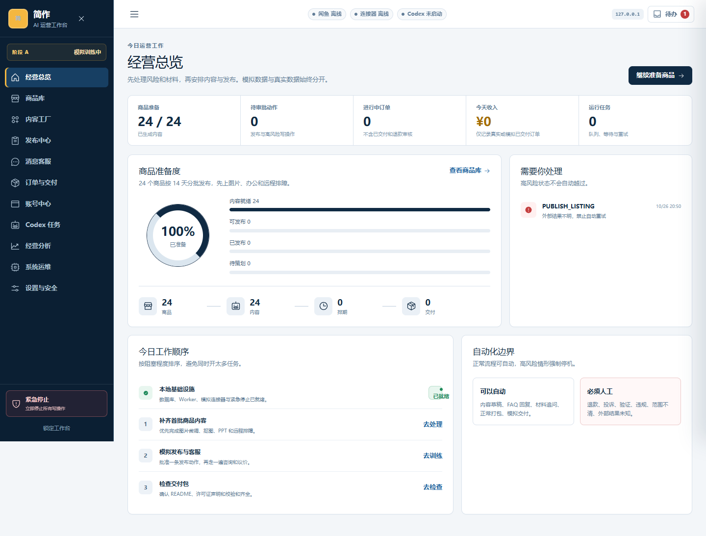
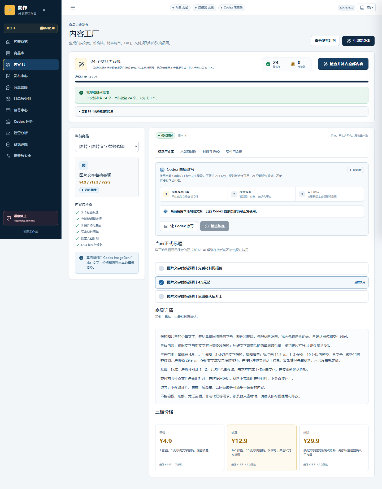

# 简作 · 本地运营工作台

把商品方案、内容、审批、制作任务和交付记录放进同一套本地流程。项目保留Web界面、Fastify API、SQLite/WAL、持久队列、模拟站、Manifest V3扩展、Electron壳与备份工具的完整源码。



## 快速上手：本机模拟流程

本轮实测Windows、Node.js24和pnpm10.33.2。在源码根目录运行：

```sh
pnpm install --frozen-lockfile --ignore-scripts
pnpm build
pnpm start
```

打开 http://127.0.0.1:8787 ，按页面提示创建自己的6–12位本地PIN，先使用阶段A的模拟训练。默认代码包含24条服务规格作为初始目录；本轮所有订单、账号与操作证据均来自新建的临时测试库，没有导入原店铺数据库或买家资料。

忽略安装脚本不会安装Electron桌面二进制，API/Web和模拟流程仍可运行。需要可选桌面壳时另行按Electron官方安装方式准备匹配版本；本轮只验证其源码编译，未做native桌面启动。开发模式用`pnpm dev`；停止服务按Ctrl+C。首次构建需要从锁文件安装依赖，仓库不附缓存。

## 已有实现与边界

- 商品、逐商品规则文案、六图模板、素材与内容版本。
- 审批、Action Outbox、持久任务、未知结果封存与恢复。
- 模拟站与扩展页面适配、当前目标/账号/页面证据守卫。
- 本地PIN、加密备份、订单同意、数字打包与记录摘要。
- 可选Codex App Server、图片产物和真实账号连接入口；实际可用性取决于本人配置、授权及当前平台。

本轮未使用真实闲鱼账号、未执行真实发布/回复/交付、未验证模型生成。图片测试验证的是程序生成的六图模板，不能称为已逐件完成AI图片设计。完整应用依赖本机API；[在线导览](https://yangwei251003.github.io/jianzuo-workbench/)展示真实模拟界面与运行方法。



## 技术与结构

| 目录 | 内容 |
|---|---|
| `apps/web`、`apps/api`、`apps/worker` | React/Vite、Fastify、本地任务处理 |
| `apps/mock-xianyu`、`apps/extension` | 自有模拟站、Manifest V3适配实验 |
| `apps/desktop` | Electron壳与托盘源码 |
| `packages/contracts`、`core`、`database` | 类型契约、策略/内容/目录、SQLite迁移 |
| `scripts`、`tests`、`docs` | 本地工具、完整原有测试、历史开发说明与本轮验证 |

原`.git`历史不推送；保留本地21处未提交业务改动对应的最新源码。外部`xianyu-super-butler`下载目录、个人快捷方式、未确认来源且未被代码引用的示例PNG没有混入此独立实现。自有代码采用[MIT](LICENSE)，依赖、外部软件和平台商标仍归原权利人。

## 数据与验证

`data/`包含本人的库、文件、密钥材料及专用浏览器状态，始终只留本地；也可用`JIANZUO_DATA_DIR`选择独立私有目录。服务只监听127.0.0.1。日志、账号配置、备份、浏览器Profile、真实交易/客户与私人文件均不在公开源码中。源码中的示例商品定价是应用初始配置，不是个人财产或经营流水。

同主版本安全修补后重新通过：类型检查、完整构建、173个原有单元测试、33个原有Chrome E2E，包含模拟发布、订单同意/打包、结果未知不重放、账号/页面不一致停止等场景。见[验证记录](docs/VERIFICATION.json)。生产/完整依赖各保留1条moderate，0high/critical；原因和可达性推断见[依赖状态](docs/DEPENDENCY_SECURITY.md)，不把测试通过当作真实平台生产验收。

## 更新与计划

2026-10-26：完整归档最新业务源码、测试和迁移；过滤原运行资料并泛化手册机器路径，补充实际模拟图和可复现入口。后续继续验证桌面壳、本人受控的真实账号与模型产物；涉及外部操作应按软件现有授权流程执行。原目录含未公开私人状态，当前不可据此整目录删除。
